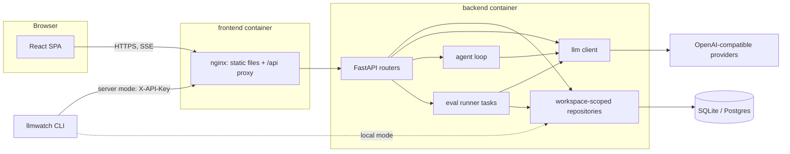
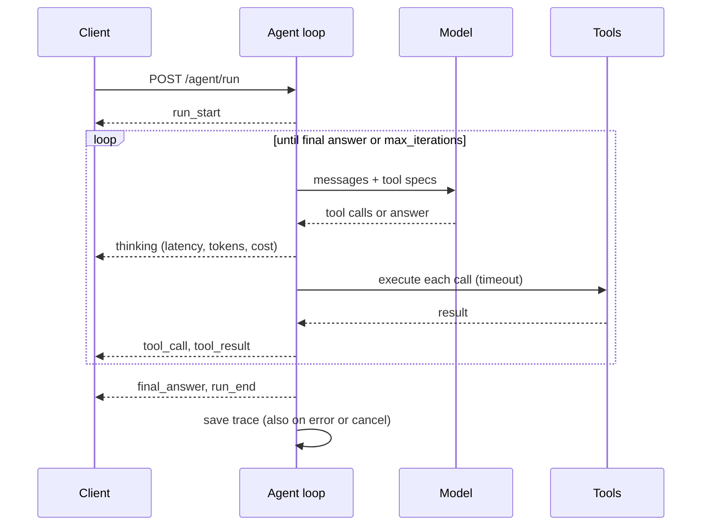

# LLMWatch architecture

LLMWatch is one FastAPI process and one database, served behind nginx together with a React SPA. There are no queues, caches or cloud services to run. This document describes how the pieces fit together and why they were chosen.

## Overview

- **nginx** serves the built SPA and proxies `/api/` to the backend with buffering off and a one-hour read timeout, so Server-Sent Events stream through. It overwrites `X-Forwarded-For` with the real peer address.
- **The backend** is the only process that talks to the database and to model providers. Migrations run on startup (`AUTO_MIGRATE`). Runs left `running` by a previous process are marked `interrupted` and can be resumed.
- **The CLI** (`llmwatch eval …`) uses the same code in-process against the local database, or the HTTP API with an API key.

## Backend modules (`backend/src/llmwatch`)

| Package | Responsibility |
|---|---|
| `config.py` | Settings from the environment. The secret key is generated on first boot if unset, and HKDF derives separate JWT and Fernet keys from it |
| `db/` | Async SQLAlchemy engine (SQLite WAL with foreign keys on, or Postgres), models, Alembic migrations, `WorkspaceRepository` base |
| `auth/` | Password hashing (bcrypt), JWT (PyJWT), the dependency that accepts a bearer token or `X-API-Key` |
| `providers/` | Provider presets, CRUD, encrypted keys, connection test and model discovery, the model registry and `resolve_model` |
| `llm/` | OpenAI-compatible async client: chat, streaming, usage (including streamed usage), reasoning extraction, tool calls, error mapping into a retryable/non-retryable `LLMError`, cost from prices, per-provider reasoning controls |
| `services/` | Accounts and workspaces, chat orchestration and call logging, analytics queries, optional MLflow mirror |
| `agent/` | Tool registry (`web_search`, `fetch_url`, `query_usage`, optional `python`), the tool-calling loop, SSE event types, trace persistence |
| `evals/` | Suite schema and `{{ var }}` templates, versioned storage, evaluators, the runner, response cache, provider limiter, statistics, comparisons, CLI |
| `security/` | The SSRF-safe fetcher used by `fetch_url` |
| `routers/` | The HTTP API: thin handlers that validate input and call the modules above |
| `rate_limit.py` | slowapi limits keyed by API key, then user, then trusted client IP |

## Data model

Every table except `workspaces` carries a `workspace_id`, and deleting a workspace cascades to all of it. Repositories take the workspace id in their constructor and add it to every query, so a handler cannot forget the scope.

| Table | Holds |
|---|---|
| `workspaces`, `users`, `api_keys` | Tenancy and auth. API keys are stored as SHA-256 hashes |
| `providers`, `models` | Provider base URL and encrypted key, model metadata (capabilities, prices, default) |
| `llm_logs` | One row per model call from chat, agent or evals: model, provider, tokens, latency, cost, success/error, previews |
| `agent_traces` | One row per agent run with its steps as JSON, the final answer, totals and status |
| `eval_suites`, `eval_suite_versions`, `eval_cases` | A suite, its immutable versions (template and assertions), and each version's cases |
| `eval_runs`, `eval_results` | A run of one variant against one suite version, with its pricing snapshot, and one result per case and repeat |
| `response_cache` | Cached model responses keyed by a hash of model, parameters, messages and repeat index (per workspace) |

## Request flows

### Chat

`POST /chat/stream` resolves the model reference, builds the messages, applies the provider's reasoning controls, and streams `start`, `reasoning`, `delta`, `usage`, `error` and `done` events. If the client disconnects, the upstream request is cancelled. Every call is written to `llm_logs` when it finishes, including failures and abandoned streams, so error rates and spend are complete.

### Agent

The loop is plain asyncio with no framework. Tool errors go back to the model as tool results, so it can recover. Cancellation comes from a client disconnect or `POST /agent/runs/{id}/cancel`.

### Eval run

1. `POST /evals/runs` creates one `eval_runs` row per variant, pinned to a suite version, with a snapshot of the model's prices. Each run then starts as a background task.
2. The runner expands cases × repeats, skips items that already have a result (this is what makes resume work), and processes the rest with a per-run concurrency bound and a per-provider limiter (concurrency plus requests per minute, shared by all runs).
3. Each item renders the template strictly, checks the cache, calls the model, and retries retryable errors with full-jitter exponential backoff that honors `Retry-After`. It then runs the evaluators and commits the result immediately.
4. A failed item is stored with score 0 rather than dropped, so hard cases count against a model instead of quietly disappearing.

### Comparison

`compare.py` pairs results by `(case_id, repeat_index)`, using only pairs present in both runs. It computes:

- **Score:** paired bootstrap of the mean difference (10,000 resamples, fixed seed, percentile 95% interval). It is significant when the interval excludes 0, and only with at least 10 pairs.
- **Pass/fail:** McNemar's test on discordant pairs. Below 25 discordant pairs it uses the exact binomial test, otherwise χ² with continuity correction, at α = 0.05.
- **Cost and latency:** per-case means and relative change. Unpriced runs are flagged rather than counted as free.

The verdict is `improved` or `regressed` only when a test is significant; otherwise it is `no_significant_difference`. Warnings explain anything that weakens the result: few pairs, unpaired cases, different suite versions, unpriced models.

## Key decisions

- **OpenAI-compatible HTTP only.** Every supported provider, including Gemini and local servers, speaks the same chat-completions API. One client with presets replaces per-provider SDKs and keeps cost and usage handling identical across them.
- **SQLite by default, Postgres optional.** A single file on a volume makes `docker compose up` work without configuration. The same models and migrations run on Postgres, and CI runs the suite against both.
- **No Jinja in templates.** Suite files may come from anywhere. `{{ var }}` substitution with strict missing-variable errors cannot execute code.
- **Statistics before verdicts.** Small eval suites are noisy. Reporting intervals and tests, and refusing to call 3 cases "significant", keeps the comparison honest. That honesty is the main reason the eval module exists.
- **Prices are user data.** Model prices change and differ by account, so none are bundled. Runs snapshot the prices they used.
- **Code execution is opt-in and not called a sandbox.** Resource limits reduce the damage a bad snippet can do; they do not contain malicious code.

## Frontend (`frontend/src`)

React 19 with Vite and Tailwind v4. Pages are lazy-loaded routes (`routes/`). Server state lives in TanStack Query, and API modules (`api/`) are typed by hand-written interfaces in `types/`. SSE parsing (`lib/sse.ts`) handles events split across chunks and is unit-tested. Shared UI primitives sit in `components/ui`, and the model picker, waterfall, charts and eval widgets have their own folders.

## Testing

- **Backend:** pytest against a temporary SQLite file per test (or `TEST_DATABASE_URL`), with a fake OpenAI-compatible provider. An autouse fixture fails any test that opens a non-loopback connection.
- **Frontend:** vitest for parsers, formatters and helpers, plus a test that keeps unverified claims off the public pages.
- **CI:** lint, format, tests and coverage; the whole suite on Postgres with a migration round trip; a frontend build; and a Docker Compose smoke test.
